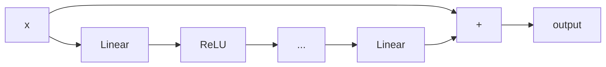

The MLP (MultiLayer Perceptron) or *feedforward neural network* is METIS's most basic architecture.

## When this might be a good fit

The MLP is a good starting point for datasets with only static inputs. It is very fast to train and generate predictions from. Unlike the Normalising Flow or Flow Matching architectures, the MLP is a deterministic surrogate. Compare validation performance before choosing a more complex model.


## How does an MLP work?

### Architectural walkthrough
An MLP's computation is a series of matrix multiplications composed with non-linear activations. METIS's implementation also includes *residual* connections which stabilise the training of deeper networks.

In order to get a better sense of how these components work let's trace through the network's forward computation:


```python
x = self.input_layer(inputs)
for block in self.blocks:
    x = block(x)
x = self.output_layer(x)
```

The input_layer linearly projects (i.e. a matrix multiplication) the static input vector to vectors the size of the model's hidden dimension. Next, we iteratively pass our transformed inputs through a series of residual blocks.

Each residual block applies several layers to the input and adds the result back to the original input:



Finally, the output layer linearly projects `x` to the output dimensionality.

### Training
The MLP is trained to minimise the mean squared error between standardized predictions and simulations:

$$
\mathrm{Loss} = \frac{1}{M}\sum_{m=1}^{M}(\mathrm{MLP}^{\theta}(\mathrm{static\_input}_m)-\mathrm{output}_m)^2
$$

## Configuring an MLP

Pass architecture options to `Surrogate("mlp", model_options={...})`:

| Option | Meaning | Default |
|---|---|---:|
| `hidden_dim` | Width of the hidden layers | 64 |
| `num_blocks` | Number of residual blocks | 2 |
| `num_layers_per_block` | Layers in each residual block | 2 |

Input and output dimensions are inferred from the simulation bank. The same
options can be set through [Hydra](../basics/hydra.qmd):

```bash
uv run metis train model=mlp model.model_options.hidden_dim=128
```

## Training on SIRDS

We use the full [SIRDS bank](../basics/sirds-example.qmd): 1,000 parameter
settings, five realisations per setting and all 200 daily outputs. The grouped
split matches the [training tutorial](../basics/training.qmd): 600 settings for
training, 200 for validation and 200 for testing. This CPU fit uses 1,000
optimizer steps.

```{python}
import numpy as np
import matplotlib.pyplot as plt
from metis import load_example, Surrogate, TrainingConfig

bank = load_example()
split = bank.split(seed=42)
```

```{python}
model = Surrogate(
    "mlp",
    model_options={"hidden_dim": 64, "num_blocks": 2, "num_layers_per_block": 2},
).fit(
    split.train, split.validation,
    config=TrainingConfig(steps=1000, batch_size=64, eval_every=100, seed=42),
)
```

```{python}
#| code-fold: true
#| code-summary: "Plot training and validation loss"
#| fig-cap: "MLP: loss on the full SIRDS bank: 600 training settings and 200 validation settings."
validation = [row for row in model.history if "validation_loss" in row]
fig, ax = plt.subplots(figsize=(6, 3))
ax.plot([row["step"] for row in model.history],
        [row["train_loss"] for row in model.history], alpha=0.5, label="Training")
ax.plot([row["step"] for row in validation],
        [row["validation_loss"] for row in validation], "o-", label="Validation")
ax.set(xlabel="Optimizer step", ylabel="MSE (standardized data)")
ax.legend()
fig.tight_layout()
plt.show()
```

Predict an entire trajectory at the first held-out parameter setting. A
deterministic prediction aims to capture the conditional average, whereas the
simulator produces different realisations at the same inputs.

```{python}
inputs = split.test.inputs[:1]
prediction = model.predict(inputs)[0]
print("Predicted times × outputs:", prediction.shape)
```

```{python}
#| code-fold: true
#| code-summary: "Compare the prediction with SIRDS simulations"
#| fig-cap: "MLP: prediction and five SIRDS simulations at the first held-out parameter setting. The model was fitted to 600 settings from the full 200-day SIRDS bank."
same_inputs = np.all(split.test.inputs == inputs[0], axis=1)
replicates = split.test.outputs[same_inputs]
fig, axes = plt.subplots(2, 2, figsize=(8, 5), sharex=True)
for channel, ax in enumerate(axes.flat):
    ax.plot(bank.times, replicates[:, :, channel].T, color="0.6", alpha=0.7)
    ax.plot(bank.times, replicates[0, :, channel], color="0.6", label="SIRDS simulations")
    ax.plot(bank.times, prediction[:, channel], color="C0", label="MLP prediction")
    ax.set(title=bank.output_names[channel], xlabel="Time (days)", ylabel="People")
axes[0, 0].legend(fontsize=8)
fig.tight_layout()
plt.show()
```

Compare predictions over the whole held-out bank, not just one setting; the
[training tutorial](../basics/training.qmd) shows how to evaluate the fit.
