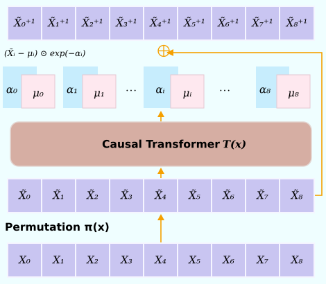

The normalising flow model is a stochastic surrogate with efficiently computable exact density.

## When this might be a good fit


The normalising flow surrogate is a good option when stochasticity and/or evaluating the exact density of the surrogate is needed. Access to this density enables the surrogate to be used in parameter inference pipelines like MCMC, Variational Inference or Simulation-Based Inference (SBI).

Architecturally it is implemented as a Transformer Autoregressive Flow (TARFlow), which is a modern normalising flow design that composes transformer blocks into an end-to-end invertible architecture. Its typical training cost is somewhere between the transformer surrogate and the flow matching model and its inference cost is similar to the flow matching model. The public iTARFlow API currently supports static inputs only.

<!-- TODO: the kinds of problems an iTarFlow surrogate suits; note the exact
likelihood, which matters for the SBI section. -->

## How Normalising Flows work

### Maximum likelihood via change of variables
A Normalising Flow parametrises an invertible transformation $f_{\theta}$ from the data distribution $p_{\mathrm{data}}$ to a noise distribution $p_0$ (usually Gaussian). Once trained the network can be inverted to transform noise samples into data. This transformation also has an associated density $p_{\mathrm{model}}$ which is accessible via the change of variable formula

$$
\log p_{\mathrm{model}}(x)=\log p_0(f_{\theta}(x))+\log\vert\mathrm{det}(\frac{df_{\theta}(x)}{dx})\vert
$$

Architecturally Normalising Flows are designed to be exactly invertible with log-determinants that can be efficiently computed. This allows a maximum likelihood estimation objective to be implemented as

$$
\min_{\theta}\; -\log p_0(f_{\theta}(x))-\log\vert\mathrm{det}(\frac{df_{\theta}(x)}{dx})\vert
$$


### Architecture

Normalising Flows have a rich literature with architectures that make different tradeoffs and until recently they were not regarded as scalable as generative models. Recently, the Transformer Autoregressive Flow (TARFlow) [@tarflow] has emerged as a scalable approach to Normalising Flows. Like many Normalising Flows the overall network $f_{\theta}$ is a composition of several invertible *blocks* $f_{M}\circ f_{M-1}\cdots\circ f_{1}$. Each of these blocks flips the order of the sequence with $\pi(x)$, and predicts scale $\alpha$ and shift $\mu$ parameters for each of the elements in the sequence with an autoregressive transformer $T(x)$:
$$
\begin{align}
&x^{\mathrm{output}}_{i}=(x^{\mathrm{input}}_{i}-\mu_{i})\odot \exp (-\alpha_i)\\
&\text{where } \mu_i \text{ and } \alpha_i \text{ are predicted by } T(x_{<i})\\
\end{align}
$$


::: {#fig-tar-block}
{fig-alt="An invertible transformer autoregressive flow block predicts scale and shift."}

Transformer Autoregressive Flow Block. Adapted from @tarflow.
:::

Crucially, since the transformer is causal, $\alpha_i$ and $\mu_i$ only depend on the elements strictly preceding $i$. Hence, the block can be exactly inverted by autoregressively rolling out

$$
x^{\mathrm{input}}_{i}=(x^{\mathrm{output}}_{i}\odot\exp(\alpha_i))+\mu_i
$$


:::{.callout-warning}
Normalising Flows are known to struggle with numerical issues on high dimensional data like images. To overcome this, @tarflow train on noise-augmented data, and apply *Tweedie's trick* to produce clean samples at inference. The downside of this approach is substantially more expensive inference and the loss of exact density evaluation.

In Metis we have not implemented this as the original authors reported no such issue in their experiments on two malaria simulators; this is not a guarantee for a new bank.
:::


## Configuring an iTarFlow model

The normalising flow is configured via these variables:

* `channels`: The width of the network
* `patch_size`: The number of timesteps per sequence element processed by the model. Defaults to `1`, increasing it reduces the length of the sequence the model has to process at potentially the cost of some performance.
* `num_blocks`: Number of TARFlow blocks
* `num_layers`: Number of layers per TARFlow block
* `num_heads`: Number of attention heads
* `num_static_tokens`: Number of tokens used for conditioning on the static input


The installed `model=itarflow` preset uses `channels=64`, `num_layers=2`,
`num_blocks=2`, `num_heads=4`, `num_static_tokens=4`, `patch_size=1`.
The sequence length must be divisible by `patch_size` and the channel width must
be compatible with the attention heads. Data dimensions are inferred.

```bash
uv run metis train model=itarflow model.model_options.channels=128
```

Use `Surrogate("itarflow", model_options={"channels": 128})` in Python.
The [likelihood exercise](../sbi/vi-mcmc.qmd) demonstrates density values and
parameter gradients in original units. The density is exact for the fitted
continuous flow, not the simulator's unknown likelihood or a count probability.
