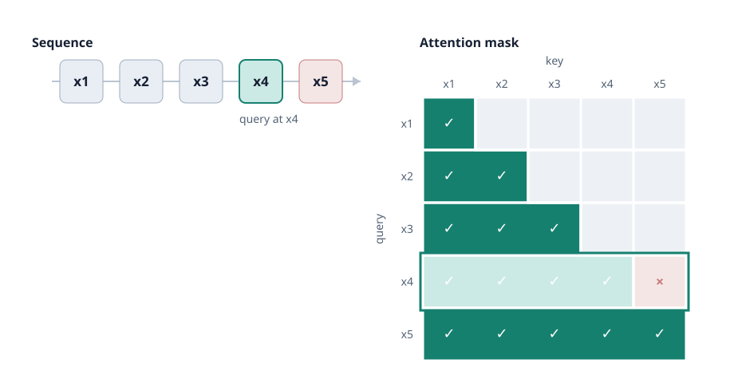
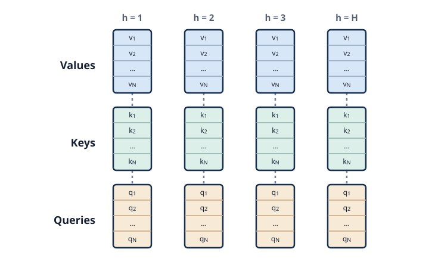
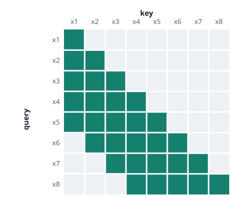
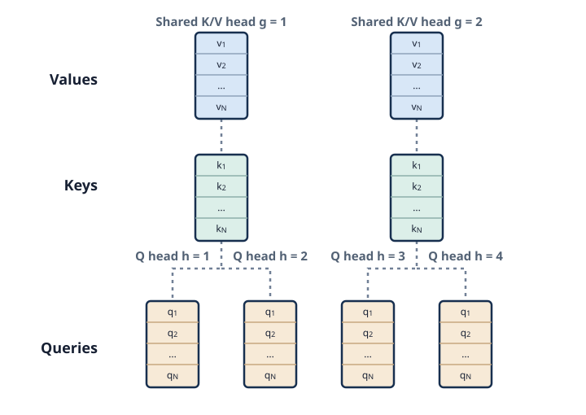

The autoregressive transformer model is a flexible and deterministic surrogate.

## When this might be a good fit

The transformer is a great option when a deterministic surrogate suffices. Furthermore, it is more flexible than an MLP, supporting conditioning on both static inputs and sequences. The installed API uses a fixed training grid; observed sequences are explicitly selected conditioning channels rather than an arbitrary observed prefix.

Unfortunately, Transformer surrogates are slower to train and infer with and often require more tuning to match the performance of an MLP. However, they tend to benefit more from scaling data or the size of the network.

<!-- TODO: the kinds of problems a Transformer surrogate suits. -->

## How transformers work

### Architectural walkthrough
The transformer architecture is substantially more complex than an MLP's so we won't cover it in great depth here.

The most important part of the Transformer architecture is the *self-attention* mechanism which enables the model to process sequence data in a highly expressive way. In an attention computation, the entries of an incoming sequence $x_1, x_2, \dots, x_n$ are given corresponding *query*, *key* and *value* vectors via projection matrices (e.g. $q_1=W_{q}x_1^T$).  These entries are collected in a $Q$ (query), $K$ (key) and $V$ (value) matrix and the transformed sequence is computed via $y=\mathrm{softmax}(\frac{QK^T}{\sqrt{d}})V$. In an autoregressive transformer this computation is restricted so that query vectors may only *attend* to key vectors from the past:

::: {#fig-causal-attention}
{fig-alt="Causal self-attention mask showing that x4 can attend to x1 through x4 but not x5."}

Causal self-attention: each input may attend to itself and earlier inputs, but not future inputs.
:::

::::{.callout-note}
In practice *multi-head* attention is used, where models have several projection matrices and perform attention over the different sets of projections independently and in parallel and then combine the results.

::: {#fig-multi-head-attention}
{fig-alt="Multi-head attention with query, key, and value sequences for four heads."}

Multi-head attention: Each block is a projected sequence of query, key, or value vectors.
:::
::::

During training the attention computation can be done over entire sequences at once (this is a major strength of the transformer), however, during inference, the sequence is iteratively generated. Since the latest entry in the sequence still needs to attend to every entry that came before it we are forced to either repeatedly recompute prior *key* and *value* vectors or to store them in a *Key-Value Cache* (KV-Cache). For larger transformers or generating longer sequences using a KV-Cache can significantly speed up inference.

In Metis we also support options like interleaving full self-attention with *sliding window* attention which halves the maximum size of the attention window for a computational speedup:


::: {#fig-sliding-window-attention}
{fig-alt="Sliding window attention limits each position to nearby earlier positions."}

Sliding window self-attention: Later tokens may not attend to the furthest tokens in the past.
:::

We additionally support specifying fewer key-value heads (i.e. projections) than query heads to make attention more efficient and reduce the size of the KV-cache. This is known as *Grouped-Query Attention*.

::: {#fig-grouped-query-attention}
{fig-alt="Grouped-query attention with four query heads sharing two key-value heads."}

Grouped-query attention: Multiple query heads share each key-value head.
:::

<!-- TODO: brief primer — attention, embeddings, sequence conditioning. -->

### Training

Language transformers train with *Cross-Entropy Loss* over tokens but since our data is typically continuous, we use a next-token MSE loss.

## Configuring a Transformer

The installed `model=transformer` preset uses `n_layer=2`, `n_head=4`,
`n_kv_head=4`, `n_embd=64`. Layers control depth; embedding width controls capacity.
Query/key-value heads split attention into subspaces. Width must divide cleanly
among the heads, and query heads must be compatible with key-value heads.
Sequence length and static/output dimensions come from the bank.

```bash
uv run metis train model=transformer model.model_options.n_layer=4 model.model_options.n_embd=128
```

Optional architecture settings include `window_pattern` (`L` full attention,
`S` shorter context), `rope_base` and `in_and_out_biases`. To add an option omitted
from the preset, use e.g. `+model.model_options.window_pattern=SL`. Defaults use
full attention. Configure observed sequences through
`model.observed_outputs=[intervention]`, not a low-level cross-attention object;
see [sequence conditioning](../package/conditioning.qmd).

The public API predicts the fitted fixed grid. The underlying autoregressive
architecture does not imply public support for arbitrary horizons or observed
prefix continuation. Evaluate autonomous rollouts as well as next-step loss.
