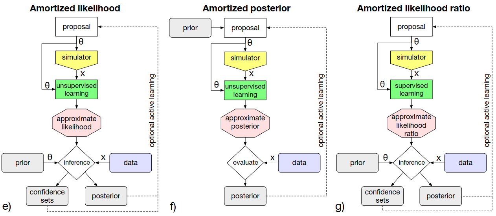

In many scientific disciplines it is commonplace to build simulations of natural systems due to the flexibility of general software compared to precisely defined sets of equations. However, these systems typically do not provide *tractable* likelihoods making parameter inference challenging. Simulation-based inference (SBI) encompasses many approximate inference techniques to overcome this issue, howerver in recent years SBI has been dominated by approaches that employ neural networks.

Most of these methods can be described as either amortising the likelihood (Neural Likelihood Estimation), the likelihood-ratio (Neural Ratio Estimation) or the posterior (Neural Posterior Estimation).

In brief, NLE fits a neural network with a tractable likelihood to simulated data, NRE learns $\frac{p(x|\theta)}{p(\theta)}$ typically through a classifier or contrastive loss and NPE learns to perform posterior inference for a given simulator and prior in a single forward pass. Unlike NPE, NLE and NRE must be substituted into inference pipelines (e.g. MCMC, Variational Inference) *every time* a new inference is required.

In Metis we don't aim to support every SBI use-case, but as our existing Normalising Flow surrogates have tractable likelihoods they can serve as NLE models.

:::{.callout-tip}
If you intend to use a surrogate in an SBI inference pipeline ensure that the prior's support is contained in the proposal/sampling distribution used to generate your data.
:::
