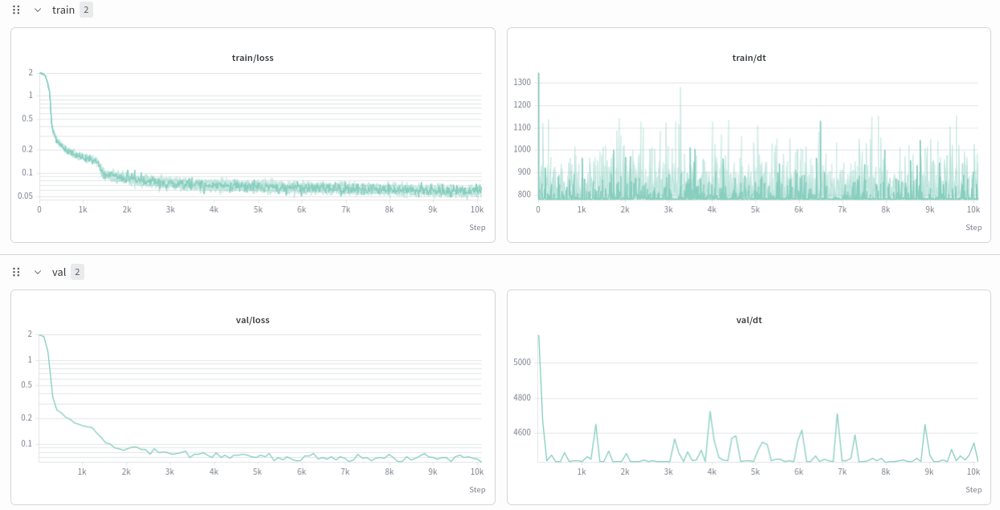
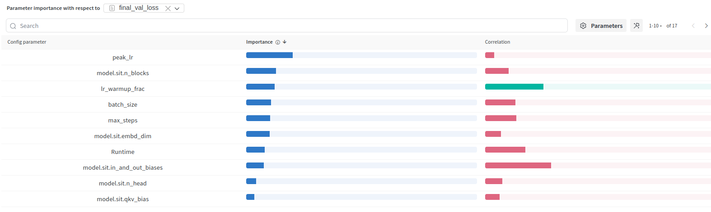

[Weights & Biases](https://wandb.ai) tracks experiments and organizes sweeps.
METIS supports it through the same optional adapter in Python and Hydra.

```bash
uv add "metis-surrogate[wandb] @ git+https://github.com/OJWatson/metis.git"
uv run metis train wandb.enabled=true wandb.mode=offline
```

Include any other extras you use in the requirement. Offline mode needs no
account. For an online run use `uv run wandb login`, then set
`wandb.project=your-project` and, if needed, `wandb.entity=your-team`.



The dashboard image comes from the original research workflow; the current adapter logs training loss at each step, validation loss at evaluation
steps and final evaluation metrics. Training and
validation losses describe optimization. Use common evaluation scores when
comparing model families.



METIS sends configuration and scalar metrics, not simulation tables or model
files automatically. The resolved configuration can include local paths and
column names. Local inference artifacts and evaluation reports are saved
independently. See [sweep configuration](sweep-config.qmd).

## Track from Python

Pass the tracker to the same `Surrogate.fit` call used in the tutorials:

```python
from dataclasses import asdict
from metis import load_example, Surrogate, TrainingConfig
from metis.tracking import WandbTracker

split = load_example().split(seed=42)
config = TrainingConfig(steps=100, eval_every=20)
with WandbTracker(
    project="my-surrogate-study",
    mode="offline",  # Change to online after configuring W&B authentication.
    config={"model": "mlp", "training": asdict(config)},
    dir="tracking",
) as tracking:
    surrogate = Surrogate("mlp").fit(
        split.train, split.validation, config=config,
        on_progress=tracking.log_training,
    )
    report = surrogate.evaluate(split.test)
    tracking.log_evaluation(report, prefix="test")
    surrogate.save("surrogate.pt")
    report.save("evaluation.json")
```

The context manager closes the run when the block finishes. Change `mode` to
`"online"` after authentication.
